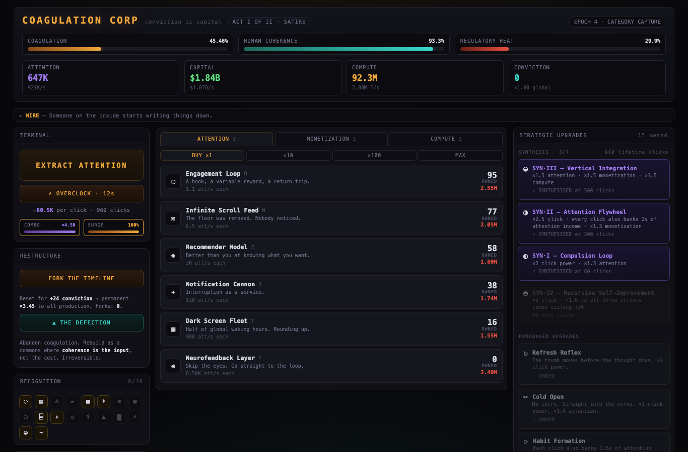

# Coagulation Corp

**Play:** https://theguysaccount.github.io/coagulation-corp-incremental-game/ · **Act II:** [/coherence/](https://theguysaccount.github.io/coagulation-corp-incremental-game/coherence/) · **All 10 endings (guide):** [/guide/](https://theguysaccount.github.io/coagulation-corp-incremental-game/guide/) · **Screens:** [docs/screens](docs/screens/)

A free satirical incremental game in two acts, in the tradition of *Universal Paperclips*. Everything in it is a work of fiction.

- **Act I: Coagulation Corp.** Turn attention into capital into compute. A Coagulation meter races a Human Coherence meter while regulators circle. Click combos, overclocks, signals, synthesis and *Fork the Timeline* prestige keep it moving.
- **Act II: Coherence Corp vs Coagulation Corp.** Take *The Defection*, found the other lab and race your old company to 200,000× data-scaling efficiency. Research tops out at 45,000×, so the rest has to walk out of their building. What you carry over (coherence, conviction, how late you left) shapes the race.
- **Ten endings.** Each gives a card to share. The game remembers which endings you have found.

No account, no ads, no cookies. Runs autosave in your browser, and save codes move them between devices. Sound is off until you turn it on. It plays on phones and computers.



## How it runs (no human in the loop)

| Job | Workflow | When |
|---|---|---|
| Content tests, build, rendered-HTML tests, both acts end to end in headless Chrome, balance check with scripted players, deploy, live check, live end-to-end test, IndexNow | `pages.yml` | Every push that touches the game, by hand, and when the self-test finds the live site behind |
| The same tests and balance check on a fresh build and against the live site, plus a staleness check, an alert issue and the keep-alive | `selftest.yml` | Weekly (Friday) |

[OPERATIONS.md](OPERATIONS.md) has the details, and the keys that need a human: a custom domain, a support link, analytics and an itch.io release.

## Layout

```
src/act1/      Act I: page.html, style.css, game.js (engine + view), data.js (assets, upgrades, synthesis, recognition)
src/act2/      Act II: page.html, style.css, game.js, data.js (buildings, research, charter, expedient, people)
src/shared/    endings.js (the ten endings), storage.js (saves, found endings), ui.js (cards, gallery, sound, sharing)
src/pages.mjs  the guide and about pages, generated from the data modules
scripts/       build, e2e, balance, check-live, screens, og image, IndexNow, keep-alive
tests/         content tests and rendered-HTML tests
```

## Run, test, deploy

Requires Node 24, plus Chrome for the browser tests.

```bash
npm ci --ignore-scripts
npm run build && npm run serve   # http://127.0.0.1:4173/coagulation-corp-incremental-game/
npm test                         # content tests, build, rendered-HTML tests
npm run e2e                      # both acts end to end in headless Chrome
npm run balance                  # pacing of both acts with scripted players
```

Every push to `main` deploys through `pages.yml`. Settings are repository variables, listed in [.env.example](.env.example). `SITE_URL` is the one address setting.

## History

The two games were written in August 2026 as separate single-page Claude artifacts. In that form they kept state only in memory, with copy-paste save codes. This repo merges them into one game:
- Coagulation Corp is Act I. Its Defection opens Coherence Corp as Act II.
- Act I's own "collective" track was folded into Act II.
- Autosave, a shared endings gallery with cards, sound, mobile layouts, a guide and tests were added.
- Trademarked and real-world names were replaced.

See [STATE.md](STATE.md), [DECISIONS.md](DECISIONS.md), [PRODUCT.md](PRODUCT.md) and [LAUNCH.md](LAUNCH.md).

## Licence

MIT. See [LICENSE](LICENSE).
